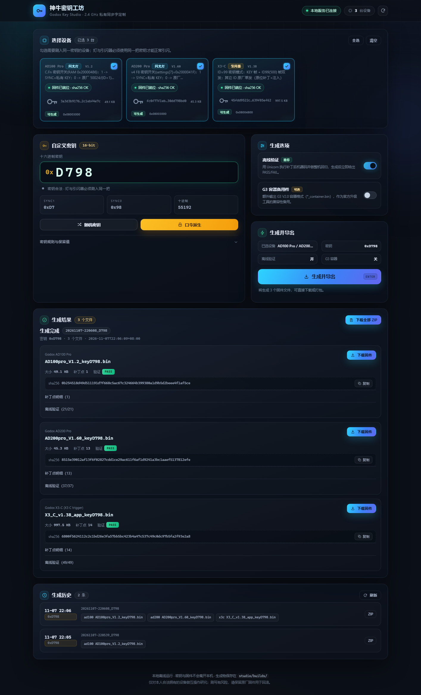

# 神牛固件研究工坊 · Godox Firmware Lab

> 面向神牛（Godox）2.4 GHz 闪光灯 / 引闪器的**固件逆向研究、模拟调试与固件定制**工具集。
> 包含：**可视化密钥工坊（studio）**、原位补丁引擎（keypatch）、多设备逆向资料与 Unicorn 模拟器。

<p align="center">
  
</p>

<p align="center"><sub>截图：真实运行中的可视化密钥工坊 —— 勾选 3 台设备、输入密钥 <code>0xD798</code>，一键生成并下载固件（含补丁点与离线验证结果）。</sub></p>

> ⚠️ **先读 [`DISCLAIMER.md`](DISCLAIMER.md)**
> 本项目只针对**你本人合法拥有的设备**做互操作研究；**不提供、不分发任何厂商固件**。
> 刷写有风险，请先确认官方升级工具能识别设备并保留原厂固件用于回滚。

---

## ✨ 核心功能

| 能力 | 说明 |
|---|---|
| **可视化密钥工坊** | 浏览器里勾选设备 → 自定义 4 位十六进制密钥（或随机 / 口令派生）→ 一键生成并导出固件 |
| **原位补丁** | 输出固件与原厂长度完全一致，官方 **G3 升级软件**可直接刷写；原厂固件不被修改，随时刷回 |
| **多设备支持** | AD100 Pro / AD200 Pro / X3-C 已支持，模板化接入 **V1C / V862C** 等新灯 |
| **离线验证** | 生成时用 Unicorn 直接执行补丁后的机器码 + 整机模拟回归 + sha256 校验 |
| **逆向资料** | 反汇编、伪 C、外设映射、2.4 GHz 协议分析、函数表、启动链报告 |
| **模拟调试** | 各设备 Unicorn 模拟器 + 网页调试器，可跑真实固件、还原屏幕、注入按键/射频 |

### 「私有密钥」是什么

神牛 2.4 GHz 链路使用 TI CC2500 兼容收发芯片，固件把引闪 ID 换算成 **16 位硬件同步字**：

```
sync = 50024 / (ID + 1)        # 原厂公式，ID = 0..99，只有 100 个公开值
```

本工具把固件里这条公式替换成「同步字 = 你的 16 位私有密钥」：

- 你的引闪器和你的灯使用同一把密钥 → 正常引闪；
- 别人的原厂引闪器只能产生那 100 个公开同步字 → 硬件层就对不上，无法引闪你的灯。

> 它挡的是「正常原厂设备误触发」，**不是密码学认证**，请勿用于防专业攻击。

---

## 📱 设备支持矩阵

| 设备 | 类型 | 固件版本 | 补丁方式 | 状态 |
|---|---|---|---|---|
| Godox **X3-C** | 引闪器 | `X3_C_v1.38_app.bin` | 双发核心 + 快捷面板 KEY/BCAST 磁贴 | ✅ 已支持 |
| Godox **AD100 Pro** | 闪光灯 | `AD100pro_V1.2.bin` | C.Fn「KEY」菜单开关（RAM 切换） | ✅ 已支持 |
| Godox **AD200 Pro** | 闪光灯 | `AD200pro_V1.60.bin` | C.Fn 第 8 项 `F8` 开关 | ✅ 已支持 |
| Godox **V1C** | 闪光灯 | 待接入 | 模板已就绪，见 [`docs/新增设备指南.md`](docs/新增设备指南.md) | 🧩 计划中 |
| Godox **V862C** | 闪光灯 | 待接入 | 同上 | 🧩 计划中 |

> 原厂固件不随仓库分发。请从官方渠道获取后放进 `devices/<设备>/firmware/`，
> 或在 studio 界面上直接拖拽上传（会校验 sha256）。
> 各版本固件的 sha256 见 [`docs/设备清单.md`](docs/设备清单.md)。

---

## 🚀 快速开始

### 1. 准备 Python

任选一种：

```powershell
# A. 用系统 Python 3.10+
pip install -r requirements.txt

# B. Windows 一键准备便携运行时（下载 Python embeddable + 依赖到 tools/python）
powershell -NoProfile -ExecutionPolicy Bypass -File tools\setup.ps1
```

项目内脚本会优先使用 `tools/python/python.exe`，否则回退到 `python`。

### 2. 放入原厂固件

```text
devices/x3c/firmware/X3_C_v1.38_app.bin
devices/ad100pro/firmware/AD100pro_V1.2.bin
devices/ad200pro/firmware/AD200pro_V1.60.bin
```

文件会被 `.gitignore` 忽略，不会进入 git。也可以跳过这步，直接在 studio 里上传。

### 3. 启动可视化密钥工坊

```powershell
# Windows：双击 scripts\start_studio.bat
# 或命令行：
tools\python\python.exe studio\server.py --port 18780 --open
```

浏览器打开 <http://127.0.0.1:18780/>：

1. 勾选要定制的设备（灯 + 引闪器可以一起选）；
2. 输入 4 位十六进制密钥（如 `D798`），或点「随机」/「口令派生」；
3. 选择是否启用离线验证 / 生成 G3 容器备用件；
4. 点「生成并导出」，下载 `.bin`（或全部打成一个 zip）。

### 4. 刷机

用官方 **G3 升级软件**：打开文件 → 选生成的 `.bin` → 更新。
灯和引闪器必须刷入**同一把密钥**的固件。详细步骤与救砖方法见 [`keypatch/README.md`](keypatch/README.md)。

### 5. 不想放固件也能先看界面

浏览器打开 <http://127.0.0.1:18780/?mock=1> 或直接用任意静态服务器托管 `studio/static/`：
`?mock=1` 会启用内置示例数据（MOCK 演示），不依赖后端、不生成真实文件，适合先体验流程。

---

## 🗂️ 目录结构

```text
.
├─ studio/                 # ★ 可视化密钥工坊（浏览器 UI + 本地 HTTP API）
├─ keypatch/               # 原位补丁引擎（CLI + 设备模块 + 验证）
│  ├─ devices/             #   每台设备一个补丁模块
│  └─ container.py         #   G3 V2.0 容器打包
├─ devices/                # 每台设备的逆向/模拟/资料
│  ├─ README.md            #   设备目录索引
│  ├─ _template/           #   新设备脚手架（V1C / V862C 从这里开始）
│  ├─ x3c/                 #   X3-C：逆向报告、Ghidra 导出、Unicorn 模拟器、网页调试器
│  ├─ ad100pro/            #   AD100 Pro：反汇编/伪 C/模拟器/Web 调试器
│  └─ ad200pro/            #   AD200 Pro：模拟器/调试器/测试
├─ docs/                   # 总览、设备清单、新增设备指南、截图
├─ scripts/                # 启动脚本
└─ tools/                  # 本机运行时与安装脚本（大件已 gitignore）
```

---

## 🛠️ 命令行工作流（不用 UI 也可以）

```powershell
tools\python\python.exe keypatch\keypatch.py list
tools\python\python.exe keypatch\keypatch.py keygen
tools\python\python.exe keypatch\keypatch.py keygen --passphrase "我的口令"
tools\python\python.exe keypatch\keypatch.py patch-all --key 0xD798 --verify
tools\python\python.exe keypatch\keypatch.py patch --device x3c --key 0xD798 --verify --out keypatch\out
tools\python\python.exe keypatch\selftest.py --key 0xD798
```

产物在 `keypatch/out/`（已 gitignore）。设备模块接口见 [`keypatch/INTERFACE.md`](keypatch/INTERFACE.md)。

---

## 🧩 后续添加新灯（V1C / V862C）

整体流程只有 5 步，脚手架已准备好：

1. 从官方渠道拿到原厂固件，记录 sha256；
2. 复制 `devices/_template/` → `devices/<新设备>/`，放入 `firmware/`；
3. 逆向找到「ID → CC2500 同步字」函数（定位方法见 `devices/<设备>/docs/`）；
4. 在 `keypatch/devices/<id>.py` 实现原位 `apply()` / `verify()`；
5. 注册设备 id —— studio 会自动出现新设备卡片。

完整步骤、检查清单与常见坑见 **[`docs/新增设备指南.md`](docs/新增设备指南.md)**。

---

## 🧪 逆向与模拟器资料

- [`docs/逆向总览.md`](docs/逆向总览.md) —— X3-C 固件逆向总报告（机型判定、启动链、显示/射频、模拟机）
- [`docs/设备清单.md`](docs/设备清单.md) —— 各设备固件 sha256、镜像基址、外设速查
- `devices/x3c/` —— Ghidra 全量导出、Unicorn 模拟机、浏览器调试界面
- `devices/ad100pro/` —— 1199 函数反汇编/伪 C、OLED 位流模拟、Web 调试器
- `devices/ad200pro/` —— 模拟器 + CLI/Web 调试器 + 自动测试

---

## ⚖️ 许可与相关项目

- 本项目原创代码/文档：**MIT**（见 [`LICENSE`](LICENSE)）；厂商固件与第三方组件不在许可范围内。
- 相关独立项目：[`Godox-S3-Trigger`](https://github.com/YuchanHu/Godox-S3-Trigger) —— ESP32-S3 引闪器固件（GPL-3.0-or-later），
  本项目的协议结论与其净室实现互为交叉验证。

> 本项目与神牛（Godox）官方无关，未获其授权或背书。
