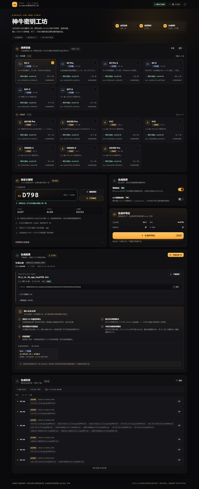
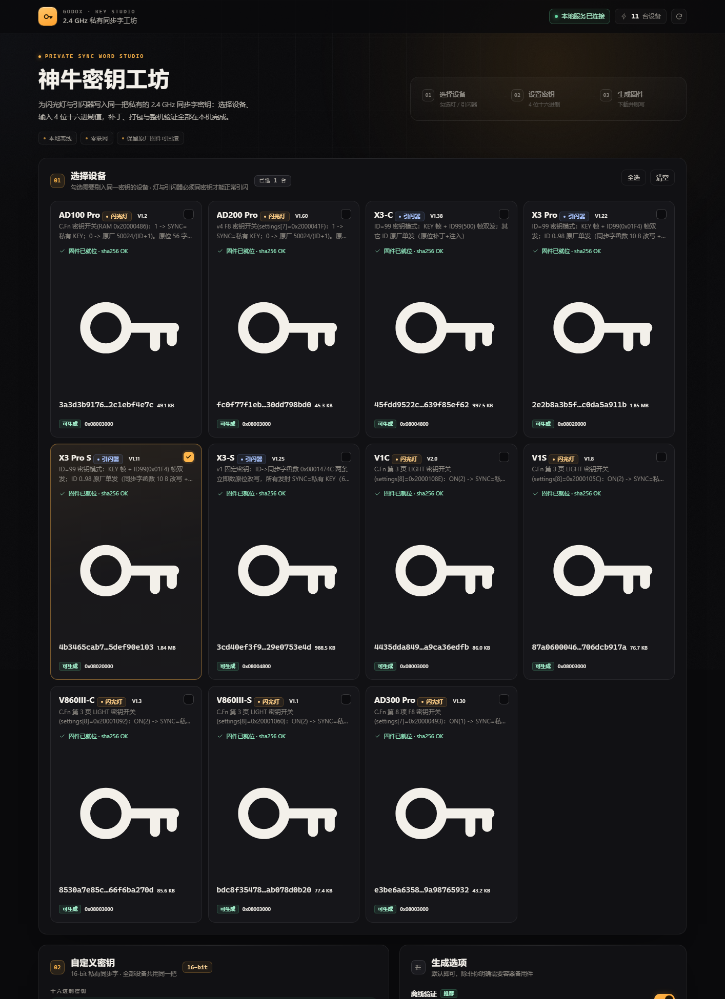
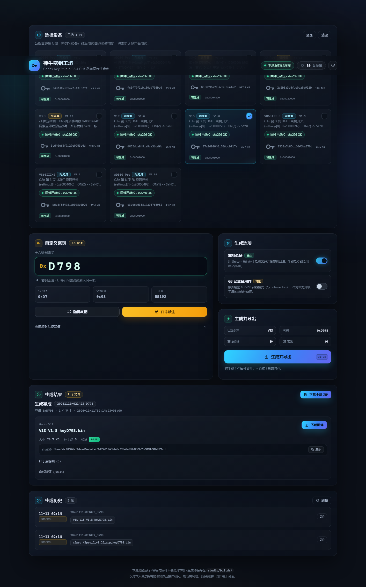

<div align="center">

# Godox Firmware Lab · 神牛固件研究工坊

**面向神牛（Godox）2.4 GHz 闪光灯 / 引闪器的固件逆向研究、模拟调试与原位固件定制工具集。**

在浏览器里勾选设备、输入一把私有同步字密钥，即可生成可直接刷写的固件；
补丁、打包与整机验证全部在本地完成，原厂固件不改动、可随时刷回。

[](LICENSE)
[](#设备支持矩阵)
[](#快速开始)
[](#快速开始)
[](#测试)

</div>

---

> [!CAUTION]
> **刷写有风险，请先读完 [`DISCLAIMER.md`](DISCLAIMER.md)。**
> 本项目只针对**你本人合法拥有的设备**做互操作研究；**不提供、不分发任何厂商固件**。
> 刷写前请确认官方升级工具能识别设备，并**妥善保存原厂固件用于回滚**。

> [!IMPORTANT]
> **知识产权权利人 / Rights Holders**
> 本项目为**个人、非官方、非商业**的互操作研究项目，与神牛（Godox）**无任何隶属或授权关系**。
> 若您认为本项目侵犯了您的权益，请见 **[LEGAL.md](LEGAL.md)**，或直接联系 **2243511192@qq.com**。
> 我们承诺在 **72 小时内**配合删除或修改，**无需律师函或正式法律文书**。
> If you believe this project infringes your rights, please contact **2243511192@qq.com** —
> we will remove or modify the content within **72 hours**, no formal legal notice required.

---

## 📖 目录

- [这是什么](#这是什么)
- [核心特性](#核心特性)
- [界面预览](#界面预览)
- [工作原理](#工作原理)
- [设备支持矩阵](#设备支持矩阵)
- [快速开始](#快速开始)
- [命令行工作流](#命令行工作流)
- [项目结构](#项目结构)
- [逆向与模拟资料](#逆向与模拟资料)
- [接入新设备](#接入新设备)
- [测试](#测试)
- [常见问题](#常见问题)
- [交流群](#-交流群)
- [贡献](#贡献)
- [许可与致谢](#许可与致谢)
- [法律声明](#法律声明-权利人通知)

---

## 🎯 这是什么

神牛闪光灯与引闪器之间通过 TI CC2500 兼容芯片在 2.4 GHz 频段通信。固件会把「引闪 ID」换算成一个 16 位硬件同步字：

```text
sync = 50024 / (ID + 1)        # 原厂公式，ID = 0..99，全人类共享这 100 个值
```

这意味着**任何一台原厂引闪器都能触发你的灯**。本项目把固件里这条公式替换为：

```text
sync = 你的 16 位私有密钥       # 例如 0xD798
```

于是：

- ✅ 你的引闪器与你的灯使用同一把密钥 → 正常引闪
- 🛡️ 别人的原厂引闪器只能产生那 100 个公开同步字 → 硬件层对不上，无法触发你的灯

> [!NOTE]
> 它拦截的是「正常原厂设备的误触发」，**不是密码学认证**，请勿用于对抗专业攻击。

---

## ✨ 核心特性

| 特性 | 说明 |
|---|---|
| 🖥️ **可视化密钥工坊** | 浏览器内完成「选设备 → 设密钥 → 生成 → 下载」全流程，无需命令行 |
| 🧬 **原位补丁** | 输出固件与原厂**长度完全一致**，官方 G3 升级软件可直接刷写；原厂文件不被修改 |
| 📱 **14 台设备** | 覆盖 X3 / X3 Pro / X2T / V1 / V860III / AD（含 AD200 Pro II）系列，模板化接入新设备 |
| 🔬 **离线验证** | 生成时用 Unicorn 实际执行补丁后的机器码，配合静态检查与 sha256 校验，给出 PASS/FAIL |
| 📚 **逆向档案** | 手写的协议分析、外设映射、补丁规格与验证记录（不含自动反编译产物） |
| 🐞 **模拟调试** | 部分设备附带 Unicorn 模拟器与网页调试器，可运行真实固件、还原屏幕、注入按键/射频 |
| 🔁 **可回滚** | 不修改原厂固件，重新刷入原版即可恢复出厂状态 |
| 🧪 **有测试** | API 16 项 + 无头浏览器 UI 17 项回归，CI 自动执行 |

---

## 🖼️ 界面预览

<div align="center">
  
  <br>
  <sub>可视化密钥工坊：分步向导式流程，勾选设备 → 设置密钥 → 生成并下载固件</sub>
</div>

<br>

| 设备选择 | 密钥设置 | 生成结果 |
|---|---|---|
|  |  |  |

> 没有原厂固件也能先体验界面：<http://127.0.0.1:18780/?mock=1>（内置示例数据，不生成真实文件）

---

## ⚙️ 工作原理

```text
┌─────────────┐      ┌──────────────┐      ┌──────────────┐      ┌─────────────┐
│  原厂固件    │ ───▶ │  keypatch    │ ───▶ │  Unicorn     │ ───▶ │  打补丁固件  │
│  *.bin      │      │  原位改写     │      │  离线验证     │      │  *.bin      │
└─────────────┘      └──────────────┘      └──────────────┘      └─────────────┘
                            │                      │                     │
                     同步字函数改写           执行真实机器码          官方 G3 工具
                     + 开关逻辑注入          校验行为正确           直接刷写
```

每台设备在 `keypatch/devices/<id>.py` 中实现两个函数：

- `apply(data, key) -> (patched, patch_log)` —— 原位打补丁，**不改变文件长度**
- `verify(patched, key) -> [(ok, msg), ...]` —— 逐项验证补丁正确性

---

## 📱 设备支持矩阵

| 设备 | 类型 | 固件版本 | 密钥开关 | 状态 |
|---|---|:---:|---|:---:|
| Godox **X3-C** | 引闪器 | `X3_C_v1.38_app.bin` | 长按拨轮/M/C ≈1.5s（打开时密钥灯嘀响一声，关闭静默；RAM 版） | ✅ |
| Godox **X3-S** | 引闪器 | `X3_S_v1.25_app.bin` | 长按拨轮/M/C ≈1.5s | ✅ |
| Godox **X3 Pro-C** | 引闪器 | `X3pro_C_v1.22_app.bin` | 长按 PA6 ≈1.5s（RAM 版） | ✅ |
| Godox **X3 Pro S** | 引闪器 | `X3pro_S_v1.11_app.bin` | ID=99 密钥模式 | ✅ |
| Godox **X2T-C** | 引闪器 | `X2TC_Z02_V1.01.bin` ¹ | C.Fn 第 4 页 `LIGHT` | ✅ |
| Godox **X2T-S** | 引闪器 | `X2T-S_V1.4.bin` | C.Fn 第 3 项 `BEEP` | ✅ |
| Godox **AD100 Pro** | 闪光灯 | `AD100pro_V1.2.bin` | C.Fn 第 7 项 `KEY`（改值即时生效，掉电保存） | ✅ |
| Godox **AD200 Pro** | 闪光灯 | `AD200pro_V1.60.bin` | C.Fn 第 8 项 `F8` | ✅ |
| Godox **AD200 Pro II** ² | 闪光灯 | `AD200ProII_V1.05.bin` | 菜单「蒙版」设为 4 加密 / 2 普通（切档需重启；**作者：夕梦**） | ✅ |
| Godox **AD300 Pro** | 闪光灯 | `AD300pro_V1.30.bin` | C.Fn 第 8 项 `F8` | ✅ |
| Godox **V1C** | 闪光灯 | `V1C_V2.0.bin` | C.Fn 第 3 页 `LIGHT` | ✅ |
| Godox **V1S** | 闪光灯 | `V1S_V1.8.bin` | C.Fn 第 3 页 `LIGHT` | ✅ |
| Godox **V860III-C** | 闪光灯 | `V860IIIC_V1.3.bin` | C.Fn 第 3 页 `LIGHT` | ✅ |
| Godox **V860III-S** | 闪光灯 | `V860IIIS_V1.1.bin` | C.Fn 第 3 页 `LIGHT` | ✅ |
| Godox **V862C** | 闪光灯 | — | 模板已就绪 | 🧩 计划中 |

<sub>¹ `X2TC_Z02_V1.01.bin` 本身是 **G3 V2.0 容器**。工具会在容器内原位修改 payload 并重算 MD5，输出仍是可直接刷写的容器，因此该设备**不需要**勾选「生成 G3 容器备用件」。</sub>
<br>
<sub>² `AD200ProII_V1.05.bin` 遮罩版低风险补丁（`ad200proii_mask`）由 **夕梦** 独立逆向、实现并完成实机验证，详见 [`devices/ad200proii/README.md`](devices/ad200proii/README.md)。</sub>

> **原厂固件不随仓库分发。** 请从官方渠道获取后放入 `devices/<设备>/firmware/`，
> 或在 studio 界面直接拖拽上传（会校验 sha256）。各版本 sha256 见 [`docs/设备清单.md`](docs/设备清单.md)。

---

## 🚀 快速开始

### 前置要求

- **Python 3.10+**
- 任选其一：Windows / Linux / macOS
- 官方 G3 升级软件（仅刷写时需要，不在本仓库）

### 1. 准备环境

```bash
git clone https://github.com/shengmojiaogexing/godox-firmware-lab.git
cd godox-firmware-lab
pip install -r requirements.txt
```

<details>
<summary>Windows 一键便携运行时（可选）</summary>

```powershell
powershell -NoProfile -ExecutionPolicy Bypass -File tools\setup.ps1
```

脚本会把 Python embeddable 与依赖下载到 `tools/python/`。项目内脚本会优先使用
`tools/python/python.exe`，找不到时回退到系统 `python`。
</details>

### 2. 放入原厂固件

将你合法获取的固件放到对应目录（文件名需与下表一致）：

```text
devices/x3c/firmware/X3_C_v1.38_app.bin
devices/x3s/firmware/X3_S_v1.25_app.bin
devices/x3pro/firmware/X3pro_C_v1.22_app.bin
devices/x3pros/firmware/X3pro_S_v1.11_app.bin
devices/x2tc/firmware/X2TC_Z02_V1.01.bin
devices/x2ts/firmware/X2T-S_V1.4.bin
devices/ad100pro/firmware/AD100pro_V1.2.bin
devices/ad200pro/firmware/AD200pro_V1.60.bin
devices/ad200proii/firmware/AD200ProII_V1.05.bin
devices/ad300pro/firmware/AD300pro_V1.30.bin
devices/v1c/firmware/V1C_V2.0.bin
devices/v1s/firmware/V1S_V1.8.bin
devices/v860iiic/firmware/V860IIIC_V1.3.bin
devices/v860iiis/firmware/V860IIIS_V1.1.bin
```

> 这些文件已被 `.gitignore` 排除，不会进入版本库。也可以跳过此步，直接在 studio 中上传。

### 3. 启动可视化密钥工坊

```bash
# Windows 可双击 scripts/start_studio.bat
python studio/server.py --port 18780 --open
```

打开 <http://127.0.0.1:18780/>，按页面上的三步向导操作：

1. **选择设备** —— 勾选需要定制固件的设备（灯与引闪器可一起选）
2. **设置密钥** —— 输入 4 位十六进制（如 `D798`），或点「随机」「密码生成」
3. **生成并导出** —— 点「生成并导出」，下载单个 `.bin` 或一键打包 ZIP

### 4. 刷入设备

用官方 **G3 升级软件**：打开文件 → 选择生成的 `.bin` → 更新。

> [!IMPORTANT]
> 灯与引闪器必须刷入**同一把密钥**的固件，否则无法引闪。
> 详细步骤与救砖方法见 [`keypatch/README.md`](keypatch/README.md)。

---

## 🛠️ 命令行工作流

不依赖界面时可直接使用 CLI：

```bash
python keypatch/keypatch.py list                                        # 列出设备与固件状态
python keypatch/keypatch.py info --device x3c                           # 查看设备详情
python keypatch/keypatch.py keygen                                      # 随机生成密钥
python keypatch/keypatch.py keygen --passphrase "我的口令"                # 由口令派生固定密钥
python keypatch/keypatch.py patch --device x3c --key 0xD798 --verify    # 给单台设备打补丁
python keypatch/keypatch.py patch-all --key 0xD798 --verify             # 给全部设备打同一把密钥
python keypatch/keypatch.py verify --device x3c --image keypatch/out/xxx.bin --key 0xD798  # 验证已打好的固件
python keypatch/selftest.py --key 0xD798                                # 全量自检
```

产物默认输出到 `keypatch/out/`（已 gitignore）。设备模块接口见 [`keypatch/INTERFACE.md`](keypatch/INTERFACE.md)。

---

## 🗂️ 项目结构

```text
godox-firmware-lab/
├── studio/                  # ★ 可视化密钥工坊（浏览器 UI + 本地 HTTP API）
│   ├── server.py            #   HTTP 服务与 API（纯标准库）
│   ├── static/              #   零构建单页前端
│   └── tests/               #   API 与 UI 回归测试
├── keypatch/                # 原位补丁引擎
│   ├── keypatch.py          #   CLI 入口
│   ├── devices/             #   每台设备一个补丁模块（apply / verify）
│   ├── container.py         #   G3 V2.0 容器打包与 MD5 重算
│   └── selftest.py          #   全量自检
├── devices/                 # 每台设备的逆向档案与模拟器
│   ├── _template/           #   新设备脚手架
│   ├── x3c/                 #   逆向报告、Ghidra 导出、Unicorn 模拟器、网页调试器
│   ├── x3pro/ · x3pros/ · x3s/    # X3 系列逆向档案
│   ├── x2tc/ · x2ts/        #   X2T 系列（含 G3 容器处理）
│   ├── v1c/ · v1s/          #   V1 系列逆向档案
│   ├── v860iiic/ · v860iiis/  # V860III 系列逆向档案
│   └── ad100pro/ · ad200pro/ · ad200proii/ · ad300pro/  # AD 系列（ad200proii 作者：夕梦）
├── docs/                    # 总览、设备清单、新增设备指南、截图
├── scripts/                 # 启动脚本
├── tools/                   # 本机运行时与安装脚本（大件已 gitignore）
└── .github/workflows/       # CI：语法检查、设备注册、API 与前端冒烟测试
```

---

## 🧪 逆向与模拟资料

| 文档 | 内容 |
|---|---|
| [`docs/逆向总览.md`](docs/逆向总览.md) | X3-C 固件逆向总报告：机型判定、启动链、显示/射频、模拟器 |
| [`docs/设备清单.md`](docs/设备清单.md) | 各设备固件 sha256、镜像基址、外设速查 |
| [`docs/新增设备指南.md`](docs/新增设备指南.md) | 接入新设备的完整步骤与常见坑 |

**按设备分类：**

<details>
<summary><b>X3 系列（引闪器）</b></summary>

- `devices/x3c/` —— Unicorn 模拟器、浏览器调试界面、手写逆向笔记（Ghidra 导出需自行生成）
- `devices/x3pro/` —— 长按 PA6 切换密钥模式（RAM 版），KEY + 原厂同步字帧双发
- `devices/x3pros/` —— ID=99 密钥模式，KEY + ID99 双发
- `devices/x3s/` —— 机内开关 + 双发核心
</details>

<details>
<summary><b>X2T 系列（引闪器）</b></summary>

- `devices/x2tc/` —— **G3 V2.0 容器**拆封、`0x0801184C` 56 B 同步字函数、C.Fn `LIGHT`（settings[14]）、保存前 hook（向量表保留槽 `0x08005010`）、34 项验证与容器 MD5 重算
- `devices/x2ts/` —— C.Fn `BEEP` 开关，52 B 整函数改写 + 保留原厂 delay+SCAL 尾部
</details>

<details>
<summary><b>V1 / V860III 系列（闪光灯）</b></summary>

- `devices/v1c/` —— 同步字函数/5 个调用点、C.Fn `LIGHT`、7 处补丁、verify 36 项
- `devices/v1s/` —— 同步字函数/5 个调用点、C.Fn `LIGHT`、5 处补丁（无需代码洞）、verify 38 项
- `devices/v860iiic/` —— C.Fn `LIGHT`，56 B 整函数改写 + 注入 hook
- `devices/v860iiis/` —— C.Fn `LIGHT`，6 处补丁、verify 73 项（含 C.Fn handler 级）
</details>

<details>
<summary><b>AD 系列（闪光灯）</b></summary>

- `devices/ad100pro/` —— OLED 位流模拟、Web 调试器、C.Fn 第 7 项 `KEY` 菜单补丁与人工重建的核心函数伪 C
- `devices/ad200pro/` —— 模拟器 + CLI/Web 调试器 + 自动测试
- `devices/ad200proii/` —— AD200 Pro II（V1.05）设置字节遮罩版低风险补丁（44 B、实机通过，**作者：夕梦**，见 [`devices/ad200proii/README.md`](devices/ad200proii/README.md)）
- `devices/ad300pro/` —— C.Fn `F8` 开关、11 处补丁规格、verify 47 项
</details>

---

## 🧩 接入新设备

整体流程只有 5 步，脚手架已准备好：

1. 从官方渠道获取原厂固件，记录 sha256
2. 复制 `devices/_template/` → `devices/<新设备>/`，放入 `firmware/`
3. 逆向定位「ID → CC2500 同步字」函数
4. 在 `keypatch/devices/<id>.py` 实现原位 `apply()` / `verify()`
5. 注册设备 id —— studio 会自动出现新设备卡片

完整步骤、检查清单与常见坑见 **[`docs/新增设备指南.md`](docs/新增设备指南.md)**。

---

## 🧪 测试

```bash
# API 回归（自动使用临时目录，不污染 studio/builds）
python studio/tests/test_api.py

# 前端 UI 回归（自动拉起无头 Edge 并通过 CDP 断言）
node studio/tests/test_ui.mjs --url http://127.0.0.1:18780/

# 补丁引擎全量自检
python keypatch/selftest.py --key 0xD798
```

CI 会在每次推送时执行语法检查、设备注册、API 测试与前端冒烟测试（见 [`.github/workflows/ci.yml`](.github/workflows/ci.yml)）。

---

## ❓ 常见问题

<details>
<summary><b>提示「原厂固件未就绪」</b></summary>

把对应原厂 `.bin` 放入 `devices/<id>/firmware/`，或在 studio 界面中上传。

</details>

<details>
<summary><b>上传报 sha256 不匹配</b></summary>

固件版本不对。对照 [`docs/设备清单.md`](docs/设备清单.md) 中的 sha256，或确认设备模块支持该版本。

</details>

<details>
<summary><b>验证失败 / 刷入后无法引闪</b></summary>

1. 先运行 `python keypatch/selftest.py --key 0xD798` 排查
2. 确认灯与引闪器刷的是**同一把密钥**
3. 确认已按设备要求开启密钥开关（C.Fn 项 / ID=99 / 长按按键）
4. X3-S / X3 Pro 系列的开关是 **RAM 版**，重启设备后需重新开启

</details>

<details>
<summary><b>端口被占用</b></summary>

换一个端口：`python studio/server.py --port 18781 --open`

</details>

<details>
<summary><b>界面空白</b></summary>

请通过 `http://127.0.0.1:18780/` 打开，而不是直接双击 HTML 文件。

</details>

---

## 💬 交流群

刷写遇到问题、交流逆向经验或接入新设备，欢迎加入 QQ 交流群：

<div align="center">

**📱 QQ 群号：[546820728](https://qm.qq.com/q/546820728)**


<sub>手机可长按图片识别二维码，或直接搜索群号 <b>546820728</b> 加入</sub>

</div>

> [!TIP]
> 提问前建议先运行 `python keypatch/selftest.py` 并附上设备型号、固件版本与报错信息，便于快速定位。

---

## 🤝 贡献

交流与提问可加入上方的 QQ 群（[546820728](https://qm.qq.com/q/546820728)）；缺陷与功能建议请走 Issue。
提交 Pull Request 前请：

1. 确保 `python keypatch/selftest.py` 与 `python studio/tests/test_api.py` 通过
2. 新设备请附带逆向档案与 `verify()` 验证项
3. **不要**提交任何厂商固件（`*.bin`）、升级工具或授权文件
4. 涉及协议结论的改动，请说明复现方式与验证依据

---

## ⚖️ 许可与致谢

- 本项目原创代码与文档：**[GPL-3.0-or-later](LICENSE)**。厂商固件与第三方组件不在许可范围内，详见 LICENSE 末尾的「许可范围说明」。
- **社区贡献署名**：**Godox AD200 Pro II（`ad200proii_mask`，V1.05 设置字节遮罩版低风险补丁）**由 **夕梦（[@PriestessVFTS](https://github.com/PriestessVFTS)）** 独立逆向、编写补丁模块并完成实机验证（许可：GPL-3.0-or-later，详见 [`devices/ad200proii/README.md`](devices/ad200proii/README.md)）。
- 相关独立项目：[**Godox-S3-Trigger**](https://github.com/YuchanHu/Godox-S3-Trigger) —— ESP32-S3 引闪器固件（GPL-3.0-or-later），本项目的协议结论与其净室实现互为交叉验证。
- 技术栈：[Unicorn](https://www.unicorn-engine.org/) · [Capstone](https://www.capstone-engine.org/) · [Ghidra](https://ghidra-sre.org/)

> 本项目与神牛（Godox）官方无关，未获其授权或背书。所有商标归其各自所有者。

---

## ⚖️ 法律声明 · 权利人通知

本项目为**个人、非商业、非官方**的互操作性研究项目：

- 与神牛（Godox）及其关联公司**无任何隶属、合作、授权、赞助或背书关系**
- **不收录、不分发**任何厂商固件、升级工具、官方文档或商标资产
- 逆向分析产物为**片段式研究笔记**，无法还原为可运行固件
- 作者的目的是支持用户为**自己拥有的设备**做兼容性调整

**若您是权利人并认为本项目侵犯了您的权益：**

| | |
|---|---|
| 📧 **联络邮箱** | **[2243511192@qq.com](mailto:2243511192@qq.com)** |
| ⏱ **下架承诺** | 收到通知后 **72 小时内**删除或修改 |
| 📄 **所需材料** | 一封说明情况的普通邮件即可，**无需律师函或 DMCA 正式通知** |
| 🤝 **态度** | 愿意以对话方式解决，不争辩、优先配合 |

完整的项目性质说明、内容边界、已采取的合规措施与处理流程，见 **[LEGAL.md](LEGAL.md)**。

<div align="center">
<sub>如果这个项目对你有帮助，欢迎点个 ⭐ Star</sub>
</div>
