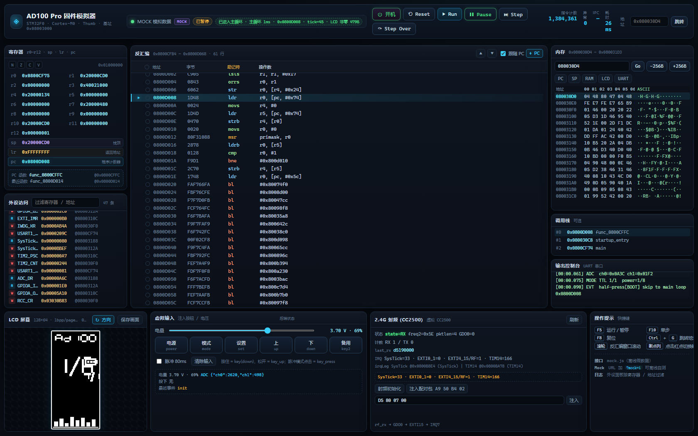
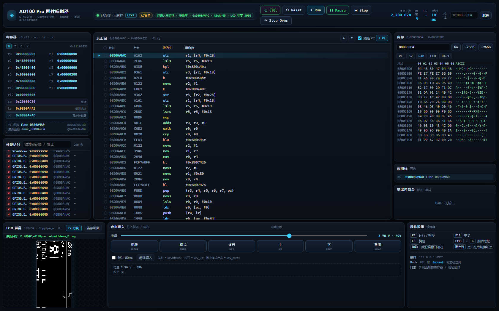
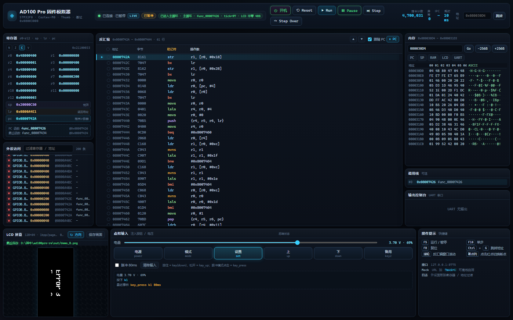
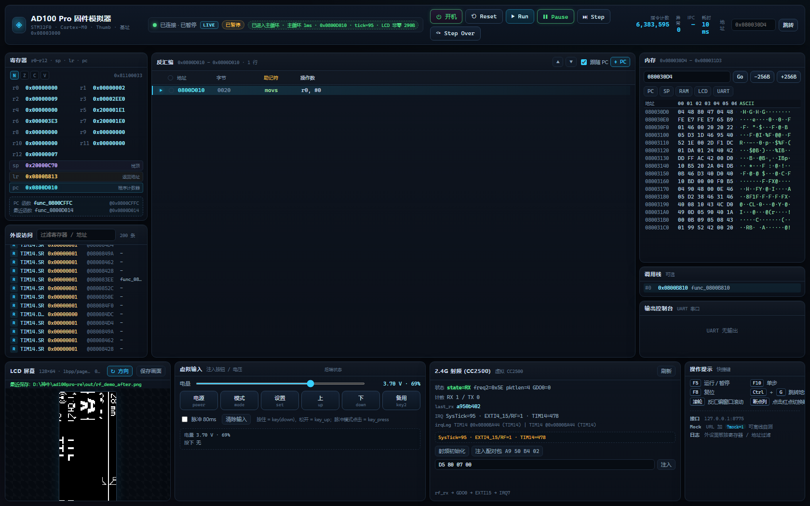

# AD100 Pro 固件模拟器 · 网页调试界面（webui）

纯静态、零外部依赖（无 CDN / 无外部字体 / 无外部 JS）的暗色调试器界面，用于观察
神牛 AD100 Pro 闪光灯固件（STM32F0 / Cortex-M0 / Thumb）在模拟器中的运行状态。



*图：`?mock=1` 离线 mock 模式（无需模拟器即可完整看到所有面板）*



*图：真实模拟器（8775）`boot_interactive → run 1M` 后：主循环 pc=0x0800A4AC、
`已进入主循环 · 主循环 · tick=45 · LCD 非零 290B`，LCD 为面板方向（rotate90+mirror）*



*图：`key_press set → run 2.5M` 后：画面变为另一状态（LCD 非零 290→48B），
虚拟输入显示「按下 k1 / 最近事件 key_press k1 80ms」*



*图：`boot_interactive → rf_init → run 1M → rf_rx A9 50 B4 02 → run 2M` 后：
RF 面板显示 `state=RX · freq2=0x5E · pktlen=4 · RX 1 / TX 0`、`last_rx=a950b402`、
`IRQ SysTick=95 · EXTI4_15/RF=1 · TIM14=478` 与最近 irqLog*

---

## 1. 快速开始

### 方式 A：Mock 模式（不需要模拟器，推荐先看界面）

```powershell
# 在仓库根执行：
tools\python\python.exe -m http.server 8080 --directory devices\ad100pro\webui
# 浏览器打开：
#   http://127.0.0.1:8080/?mock=1
```

也可以**直接双击** `webui/index.html`，在地址栏末尾加 `?mock=1`（`file://` 下同样可用，
因为 mock 模式不发任何网络请求）。

> 若 8080 被系统保留/占用（Windows 上常见 `WinError 10013`），换一个端口，例如
> `-m http.server 8088`，然后打开 `http://127.0.0.1:8088/?mock=1`。

### 方式 B：连接真实模拟器（LIVE）

```powershell
# 1) 启动模拟器 HTTP 服务（127.0.0.1:8765，CORS 已全开）
tools\python\python.exe devices\ad100pro\emu\server.py --port 8765

# 2) 另开一个窗口，静态服务 webui
tools\python\python.exe -m http.server 8080 --directory devices\ad100pro\webui

# 3) 浏览器打开（不要加 ?mock=1）
#   http://127.0.0.1:8080/
```

页面默认连 `http://127.0.0.1:8765`。需要连其他地址时加 `?api=http://192.168.1.10:8765`
（`?mock=1` 与 `?api=` 可同时存在，mock 优先）。

连接断开时界面**不会白屏**：顶部出现横幅，可点「重试连接」或「切换到 MOCK 演示」，
其余面板保留最后一次数据。

---

## 2. 界面说明

| 区域 | 内容 |
|---|---|
| 顶栏 | 标题、连接状态（LIVE/MOCK）、**⏻ 开机**（boot_interactive：reset→跳主循环→settle）、Reset / Run / Pause / Step / Step Over、指令计数、faults 异常数、IPC、接口耗时、地址跳转；状态胶囊显示 `pcName / taskPhase / virtualTicks / lcd.nonzero`（如「已进入主循环 · 主循环 1ms · tick=45」） |
| 左列 | 寄存器 r0–r12 + sp/lr/pc、xPSR 的 N/Z/C/V 标志、PC 所在函数与最近函数；下方「外设访问」滚动日志（可按寄存器名或地址过滤） |
| 中列 | 反汇编视图：PC ±30 行，当前行高亮；左侧断点列点击切换红点断点；▲/▼ 或滚轮滚动；「跟随 PC」开关 |
| 右列 | 内存视图（地址输入 / ±256B 翻页 / hex+ASCII / PC 行高亮）、调用栈（若模拟器提供）、UART 输出控制台 |
| 底部 | LCD 屏幕 canvas（128×64 1bpp **按面板方向 rotate90+mirror 显示为 64×128**，「↻ 方向」可切回未旋转、「保存画面」保存 PNG）+ **虚拟输入面板**（电量滑块、6 个按键、脉冲/清除输入、注入状态回显）+ **2.4G 射频面板**（虚拟 CC2500：state/freq2/pktlen/GDO0、RX/TX 计数、last_rx、IRQ 计数与 irqLog、射频初始化/注入配对包/任意 hex 注入）；快捷键与接口提示 |

反汇编行格式：`080030D4  0448  ldr  r0, [pc, #0x10]`（地址 · 字节 · 助记符 · 操作数）。

### 虚拟输入 / 保存画面

* **电量滑块**：2.6–4.2 V（步进 10 mV），拖动/释放时 `POST /api/cmd {"cmd":"battery","mv":N}`；
  旁边实时显示 `mV / %`，后端 `inputs` 回显后会自动同步。
* **按键**：电源 / 模式 / 设置 / 上 / 下 / 备用（`power / mode / set / up / down / key2`）。
  - 默认「按住」模式：按下 = `{"cmd":"key","key":"power","down":true}`，松开 = `{"cmd":"key_up","key":"power"}`；
  - 勾选「脉冲 80ms」后点击 = `{"cmd":"key_press","key":"power","ms":80}`。
* **注入状态**：读取 `/api/state.inputs`，显示电量、按下的键、最近事件、最近保存路径；
  后端未提供 `inputs` 时显示"未提供"，但仍会记录「本地发送」的命令，方便联调。
* **保存画面**：LCD 面板右上角「保存画面」→ `POST {"cmd":"screen_save"}`；后端返回
  `path/file/saved` 时显示路径，未连接后端时按钮禁用；后端未实现时 toast 提示。
* 键名如与 `emu/server.py` 最终实现不同，改 `app.js` 顶部 `KEY_DEFS` 即可（详见 `API.md §4.1`）。
* **真实固件落点**：固件自然启动会长时间停在启动动画循环，按键扫描到不了。联调时先
  `POST {"cmd":"jump_main","warmup":1000000}`，再 `run` 2–3M，之后注入的 key/battery
  才会被固件处理（UI 侧不受影响，状态始终回显）。推荐流程：
  `reset → jump_main → run 2M → battery/key → run 2.5M → screen_save`。
* LCD 面板下方会显示 `/api/state.lastScreenSave`（最近一次保存路径），「保存画面」
  按钮的返回路径也显示在那里。

### 快捷键

| 快捷键 | 功能 |
|---|---|
| `F5` | 运行 / 暂停 |
| `F10` | 单步 |
| `F8` | 复位 |
| `Ctrl+G` | 聚焦地址跳转输入框 |
| 鼠标滚轮（反汇编区） | 上下滚动反汇编窗口 |
| 点击断点列 | 添加 / 删除断点 |

### 断点 / 内存 / 屏幕细节

* 断点通过 `POST /api/cmd {cmd:"bp_add"/"bp_del", addr}` 同步；服务器返回 `breakpoints[]`
  时以其为准。
* 「跳转地址」只移动**反汇编视图**，不会改 PC（避免误操作）；断点/内存跟随当前视图地址。
* 内存面板快捷按钮：`PC / SP / RAM / LCD / UART`。
* LCD 支持 `gray8 / 1bpp / rgb565 / rgb888 / rgba`；其中 1bpp 会自动识别
  **SSD1306 风格 page/column 布局**（模拟器 `128×64` 屏幕即此格式）。无数据时显示占位提示。

---

## 3. 文件

| 文件 | 说明 |
|---|---|
| `index.html` | 页面骨架（只有本地 `style.css` / `mock.js` / `app.js` 三个引用） |
| `style.css` | 深色科技风样式、三栏 + 底部 LCD 布局、窄屏适配 |
| `app.js` | 轮询、字段兼容层、纯渲染函数（可在 Node 中 require 自测）、快捷键、mock 切换 |
| `mock.js` | 离线假数据后端：/api/state、/api/disasm、/api/mem、/api/screen、/api/functions、/api/cmd |
| `API.md` | UI 期望的接口契约（与 `emu/server.py` 对齐，含兼容写法与可选扩展） |
| `selftest.js` | 纯函数 / mock 数据 / 静态资源自测（不依赖 jsdom） |
| `domtest.js` | 假 DOM 冒烟测试：真正执行 `boot()`，断言各面板被渲染出内容 |
| `screenshot-mock.png` / `screenshot-live-boot.png` / `screenshot-live-menu.png` / `screenshot-live-rf.png` | mock 开机后 / 真实模拟器开机后 / 按键注入后 / RF 注入后界面截图 |

mock 数据不是随手编的：反汇编夹具来自 `out/disasm.txt` 的真实指令（含向量表、
`Reset_Handler 0x080030D4`、`main 0x0800CF74`），函数表来自 `out/functions.json`（1197 个函数）；
地址按确认后的固件基址 `0x08003000` 展示；RAM 按 8KB、栈顶 `sp=0x20000CD0`。

---

## 4. 自测（无需浏览器）

```powershell
cd devices\ad100pro\webui

# 语法检查
node --check app.js
node --check mock.js

# 1) 契约/纯函数/mock 后端自测（34 项，含虚拟输入、开机/主循环、LCD 方向、RF/IRQ）
node selftest.js
# 2) 假 DOM 全量冒烟：执行 boot()，断言 16 个寄存器行、61 行反汇编、
#    17 行内存、外设日志、UART、调用栈、LCD（rotate90+mirror 64×128）、
#    虚拟输入、开机按钮/主循环状态栏、2.4G 射频面板（63 条断言）
node domtest.js
```

最近一次结果：

```
node selftest.js  → 通过 34 项，失败 0 项
node domtest.js   → DOM 冒烟测试通过，共 63 条断言
```

`domtest.js` 的输出示例：

```
PASS  insnCount=184,361  conn=MOCK 模拟数据
PASS  regGrid 行数=16  含 pc=080030D4
PASS  funcInfo=PC 函数 Reset_Handler @0x080030D4 最近函数 func_080030D8 @0x080030D8
PASS  disasm 行数=61  范围=0x08003064 – 0x08003112 · 61 行
PASS  memTable 行数=17  memInfo=0x080030D4 – 0x080031D3
PASS  periph 行数=46  uart 行数=7
PASS  callstack=#0 0x080030D4 Reset_Handler #1 0x080030C8 startup_entry #2 0x0800CF74 main
PASS  lcd meta=128×64 · 1bpp/page · FB 0x20001000 · 面板 90°镜像  canvas 64×128
PASS  虚拟输入 battery=3.70 V · 69%  status=电量 3.70 V · 69% ADC {...} 按下 无 最近事件 init
PASS  开机按钮可用 / phaseInfo=未进入主循环 · 启动中 · Reset_Handler
```

### 无头浏览器截图 / 自动注入（可复现）

URL 支持三个联调辅助参数（不写也可，正常交互即可）：

* `?api=http://127.0.0.1:8775` — 指定模拟器地址（用于端口冲突时切换）；
* `?screen=raw` — LCD 用未旋转的 page/column 原始方向显示（默认 rotate90+mirror）；
* `?mv=3900&demo=key_press:power,key:mode` — 首帧连接后自动执行一次注入序列
  （`battery` / `key` / `key_up` / `key_press` / `screen_save` / `boot_interactive`，
  逗号分隔、冒号分参），便于无头截图验证「开机 / 注入后状态」。

本仓库三张截图就是这样生成的：

```powershell
# mock（自动开机到主循环）
msedge --headless=new --window-size=1680,1050 --virtual-time-budget=11000 ^
  --screenshot=devices\ad100pro\webui\screenshot-mock.png ^
  "http://127.0.0.1:8088/?mock=1&demo=boot_interactive"
# live-A（开机 + run 1M）
msedge --headless=new --window-size=1680,1050 --virtual-time-budget=11000 ^
  --screenshot=devices\ad100pro\webui\screenshot-live-boot.png ^
  "http://127.0.0.1:8088/?api=http://127.0.0.1:8775"
# live-B（key_press set + run 2.5M）
msedge --headless=new --window-size=1680,1050 --virtual-time-budget=11000 ^
  --screenshot=devices\ad100pro\webui\screenshot-live-menu.png ^
  "http://127.0.0.1:8088/?api=http://127.0.0.1:8775"
```

---

## 5. 接口

完整契约见 [`API.md`](API.md)。摘要：

* `GET /api/state` — 寄存器/PC/SP/LR/xPSR、指令数、运行状态、断点、外设日志、UART、
  faults、函数名、调用栈、LCD 元信息、stats、**inputs（虚拟输入回显）**、
  **pcName / taskPhase / inMainLoop / virtualTicks / lastScreenSave**
* `GET /api/disasm?addr=0x080030D4&n=61` — 反汇编窗口
* `GET /api/mem?addr=0x20000000&len=256` — hex + ascii
* `POST /api/cmd` — `run / pause / step / step_over / reset / bp_add / bp_del / set_pc /
  battery / key / key_up / key_press / clear_inputs / screen_save /
  jump_main / boot_interactive / rf_init / rf_rx / rf_status`
* `GET /api/state` 还含 `rf{state,gdo0,rx_count,tx_count,last_rx,last_tx,freq2,pktlen,patable}`、
  `irqCounts`/`irq_counts`（15=SysTick、35=TIM14、21=EXTI0_1、23=EXTI4_15/RF）、
  `irqLog`、`inIsr`、`realIrq`、`tim14Count`
* `GET /api/screen` — `{w,h,format:"1bpp",hex,data,info}`（1bpp page/column）
* `GET /api/functions` — 函数表（可选扩展，缺失时 UI 用启发式函数名）

---

## 6. 已知限制 / 排查

1. **跨域**：页面（8080）连模拟器（8765）需要 `Access-Control-Allow-Origin: *`
   （`emu/server.py` 已实现，含 OPTIONS 204）。若自建服务未开 CORS，界面会提示"无法连接"。
2. 真实模式下 `?api=` 指向的地址必须可从浏览器访问；`file://` 直接打开也可以连
   `http://127.0.0.1:8765`，但不建议用于日常（推荐 http 静态服务）。
3. **LCD 方向**：UI 默认按 `emu/main.py --screen` 的 panel 方向
   `rotate90+mirror` 显示（canvas 64×128，见「↻ 方向」按钮可切回原始方向）。
   注意 `emu/server.py` 的 `screen_save` 生成的 PNG 目前仍是未旋转的 page/column
   方向（UI 不读取 PNG，只画 `/api/screen` 原始 1bpp），若两边要完全一致可在
   emu 侧对齐或直接用「保存画面」看原始帧。
4. 真实 LCD 帧由 emulator 的 SPI/GPIO 解码得到；画面是否完整取决于解码器状态，
   UI 按 page/column 格式忠实还原。
5. mock 模式与真实模拟器数据不同（假数据用于 UI 演示/回归），但字段/地址口径一致。
6. 仅本地使用：不引入任何外部资源，可完全离线运行。
7. **端口占用提示**：本机 8765 曾被其他任务/项目的服务同时占用（Windows 允许
   `SO_REUSEADDR` 重复绑定），表现为 `/api/state` 请求偶发挂起。联调时用
   `?api=http://127.0.0.1:8775` 指向 emu 当前单实例；排查占用：
   `Get-NetTCPConnection -LocalPort 8765 -State Listen` 后按 PID 确认归属再处理。
8. `/api/state.inputs` / `lastScreenSave` / `pcName` 等是可选字段，缺失时 UI 自动降级；
   emu 最新版已提供。
