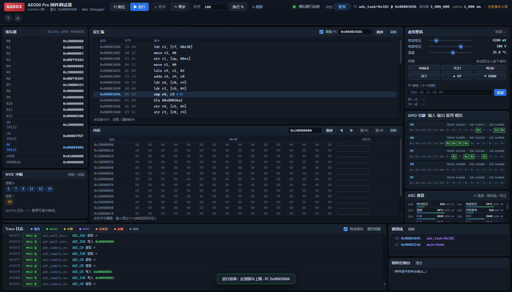

# AD200 Pro 固件逆向 + 调试模拟机

对 Godox **AD200 Pro** 闪光灯固件 `AD200pro_V1.60.bin` 的逆向工程与可运行调试模拟器。

> ⚠️ 本项目仅用于学习、固件研究与互操作性分析。固件版权归原厂商；请勿用于商业分发或绕过任何保护措施。

---



## 验证状态（2026-11-07）

| 项目 | 结果 |
|---|---|
| 自动测试 `tests/run_all.py` | **2/2 PASS**（test_boot / test_debug） |
| 启动到主循环 | **80,000 条指令 / 0.06 s**，无 fault |
| 主循环稳定运行 | 连续 Run 每次 2,000,000 条指令，PC 在 adc_task / display_task / rf_spi_write_byte 等任务间推进 |
| 中断 | TIM14(IRQ19) 节拍、SysTick、DMA、EXTI 正常注入/返回 |
| HTTP API | 全部端点 200（status/run/step/pause/reset/breakpoints GET+POST/mem/disasm/trace/symbols/device/device-event/backtrace/health） |
| Web UI 联调 | **66/66 通过**（无头 Edge + CDP，无 JS 异常；另有 mock 41/41、离线提示 10/10） |

## 目录

本目录位于仓库 `devices/ad200pro/`；仓库根的便携 Python 为
`tools\python\python.exe`（从本目录即 `..\..\tools\python\python.exe`）。

```
devices/ad200pro/
├─ firmware/AD200pro_V1.60.bin   原始固件（不改动；sha256 fc0f77f1…）
├─ python/                       本机便携 Python 3.12 运行时（已 gitignore，仅本地保留；不用时可删）
├─ tools/                        静态分析工具（adfw / analyze / make_symbols / boot_probe …）
├─ analysis/                     分析产物（反汇编、函数表、符号、MMIO、启动探针）
├─ docs/                         逆向与使用文档（见下）
├─ src/                          伪 C 重建源码（13 个文件 + include/ad200.h）
├─ sim/                          固件调试模拟机（Unicorn + STM32F0 外设模型 + 调试器）
├─ webui/                        Web 调试器前端（单页，无构建/无外网依赖）
├─ tests/                        自动测试
├─ run_sim.py                    以模块方式运行 sim.*（适配仓库根 tools\python 便携版）
└─ README.md
```

> 运行 Python 一律用仓库根的 `tools\python\python.exe`（含 capstone 5.0.7 / unicorn 2.1.4）。
> 本目录下的 `python/` 只是历史遗留的本地运行时（被 `.gitignore` 忽略），可不使用。
>
> 注意：`tools\python` 是 Windows embeddable 发行版，`sys.path` 不含当前目录，
> 因此 `python -m sim.server` 这种模块方式会找不到 `sim` 包；请用本目录的 `run_sim.py`
> 转发（它会把设备目录加入 `sys.path`）：`..\..\tools\python\python.exe run_sim.py sim.server …`。
> 用系统 Python 时仍可直接 `python -m sim.server …`。

## 快速开始

以下命令默认先从仓库根进入本目录：

```powershell
cd devices\ad200pro
```

### 1) Web 调试器（推荐）
```powershell
..\..\tools\python\python.exe run_sim.py sim.server --port 8899
# 浏览器打开 http://127.0.0.1:8899
```
> 注意：本机 8765 端口被一个无关的 "AD100Pro emu" 服务占用，请用 8899（或任意空闲端口）。
功能：Reset / Run / Pause / Step，断点、反汇编（PC 高亮）、内存读写、寄存器/NVIC、
Trace（调用/MMIO/中断/ADC/DMA/Flash）、调用栈、虚拟整机面板（电池/电容电压/温度/按键/2.4G 注入）、GPIO/ADC 实时显示。

### 2) 命令行调试器
```powershell
..\..\tools\python\python.exe run_sim.py sim.cli
(adbg) run                  # 跑到主循环（约 8 万条指令）
(adbg) bp 0x0800CE52
(adbg) regs / mem 0x20000100 64 / dis 0x0800CDB0 12
(adbg) dev set cap_voltage=330
(adbg) rf A9 50 B4 02       # 注入一帧 2.4G 数据
(adbg) trace 20 / mmio 20 / irq
```

### 3) 测试
```powershell
..\..\tools\python\python.exe tests\run_all.py
# [PASS] test_boot.py   主循环到达+稳定运行+中断注入
# [PASS] test_debug.py  断点/单步/内存/反汇编/trace/backtrace
```

## 固件事实速查

| 项 | 结论 |
|---|---|
| MCU | ARM **Cortex-M0**（STM32F0 系列内核 + F1 布局 FLASH 控制器） |
| 镜像基址 | **0x08003000**（文件偏移 = 地址 − 0x08003000） |
| Bootloader | 0x08000000–0x08002FFF（12 KiB，不在文件中，负责 USB 升级） |
| Flash | 128 KiB；参数页 0x0801F000，标志页 0x0801F800（魔数 0x100E） |
| RAM | 0x20000000–0x200008AF 使用（SP=0x200008B0） |
| 向量表 | 48 项；运行时复制到 SRAM 0x20000000 并 SYSCFG 重映射 |
| 主循环唤醒 | **TIM14 中断**（IRQ19）分频 25 → `*(u8*)0x200001CF=1` |
| 1 ms 时基 | SysTick → `*(u32*)0x20000100` 自增 |
| 2.4G | **CC2500 兼容** 4 线软 SPI：CSN=PC6，SCK=PB13，MOSI=PB12，MISO=PB14；自检读 reg0x0D==0x5C |
| 模拟量 | ADC 通道 3/10/11/12 + DMA1_CH1 → 0x20000424 |
| 人机 | 3×3 按键矩阵（PB3/4/5 × PC10/11/12）；无硬件 USART/SPI/I2C |

细节见 [docs/02-memory-map.md](docs/02-memory-map.md)。

## 模拟器能做什么

- **真实执行固件**：从 reset 开始，SystemInit → scatter-load → main → 主循环；不修改固件行为（仅运行时把忙等 delay 函数与 `wfi` 替换为立即返回以提速，可在 `Machine(fast_delays=False)` 关闭）。
- **外设行为级模型**：RCC/FLASH/GPIO(A/B/C/D/F)/EXTI/SYSCFG/ADC/DMA1/TIM1/2/14/17/PWR/IWDG/RTC/SCS(SysTick+NVIC)，含就绪位、写 1 置位 NVIC、ADC 单次/扫描+DMA、CC2500 软 SPI 从机。
- **完整调试能力**：断点、单步、寄存器/内存读写、反汇编、调用栈、事件 Trace、卡死诊断（`analysis/stall_report.json`）。
- **虚拟整机**：电池电压、电容电压（可自动充电）、温度、按键、2.4G 收发、GPIO/ADC 观测。

## 已知限制

- 外设为**行为级近似**，时序不是周期精确；TIM/SysTick 时间按“1 ms ≈ 2000 条指令”折算。
- 0x08000000–0x08002FFF 的 bootloader 不在文件中，模拟器填 0xFF，不支持 USB 升级流程。
- 显示/LCD 的物理接口未在本 APP 中直接体现（无并口/AF 常量），UI 相关任务只做状态计算与页面缓冲。
- ADC 通道与物理量（电池/电容/温度/基准）的对应为 [推测]；可在虚拟面板直接给 ADC 通道赋值。
- `src/` 是**伪 C 重建**（按反汇编逐函数还原，非原厂源码，不能直接编译为等价固件）。

## 文档索引

| 文档 | 内容 |
|---|---|
| [docs/01-static-notes.md](docs/01-static-notes.md) | 逆向过程与最初确认的事实 |
| [docs/02-memory-map.md](docs/02-memory-map.md) | **内存映射/外设/启动流程定稿** |
| [docs/03-functions.md](docs/03-functions.md) | 323 函数清单 + 调用图 + 中断表 |
| [docs/04-subsystems.md](docs/04-subsystems.md) | 逐子系统行为（时钟/ADC/充电/触发/2.4G/Flash/看门狗…） |
| [docs/05-pinmap.md](docs/05-pinmap.md) | GPIO 全引脚表与证据 |
| [docs/06-boot-peripherals.md](docs/06-boot-peripherals.md) | 启动期外设硬语义与模拟器踩坑记录 |
| [docs/SIM-SPEC.md](docs/SIM-SPEC.md) | 模拟器设计/API 契约 |
| [docs/usage.md](docs/usage.md) | 模拟器与 Web UI 使用手册 |

## 复现分析

```powershell
..\..\tools\python\python.exe tools\analyze.py        # 递归 CFG 反汇编 → analysis/
..\..\tools\python\python.exe tools\make_symbols.py   # → analysis/symbols.json
..\..\tools\python\python.exe tools\boot_probe.py     # 启动等待链探针（裸 MMIO 模型）
..\..\tools\python\python.exe run_sim.py sim.boot_trace 4000000   # 模拟器启动跟踪
```
