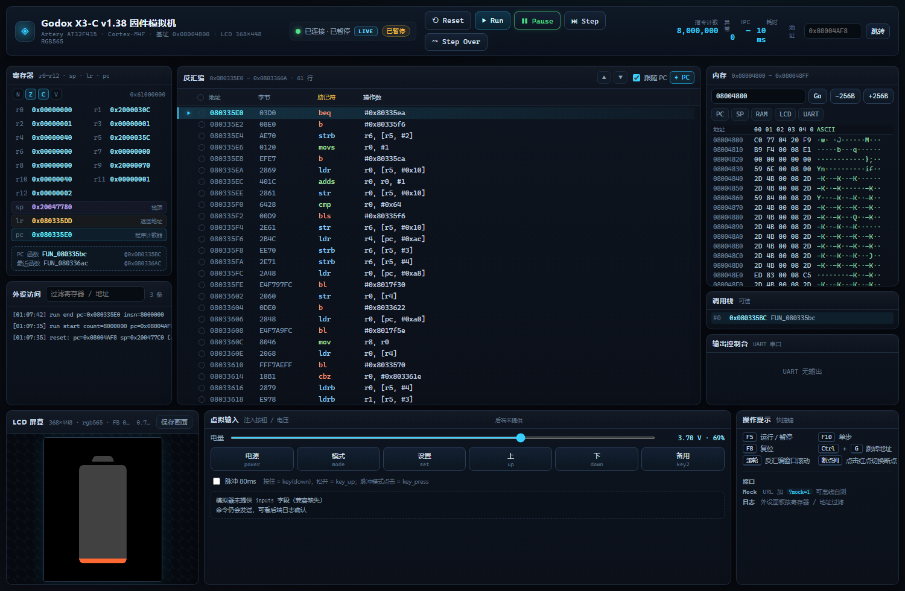

# 神牛 X3-C (X3 C) v1.38 固件逆向 + 调试模拟机

> 目标固件：`X3_C_v1.38_app.bin`（1,021,468 字节，sha256 `45fdd952…f85ef62`）
> 产品：Godox X3-C（Canon 热靴 TTL 无线引闪器）
> 工作目录：仓库根目录

本目录是一次完整的固件逆向工程与模拟器实现成果。下面先给结论，再给使用方法和证据文件位置。

---

## 一、结论速览

| 项目 | 结论 |
|---|---|
| CPU / MCU | **Artery 雅特力 AT32F435/437**，Cortex-M4F，1 MB Flash，384 KB SRAM（不是 STM32） |
| 固件格式 | 应用镜像（app.bin），**链接/加载基址 = `0x08004800`**（前面 18 KB 是未包含在文件里的厂商 bootloader） |
| 文件内布局 | `[0x00000..0x20B]` 向量表（SP=`0x200477C0`，131 项 = 16+115 个中断）→ 代码 → 压缩字库/图片资源 → 尾部 `0x0F3800..EOF` 是**第二个固件**（热靴 MCU，STM32F0 级，独立地址空间基址 `0x08002000`） |
| 启动链 | `Reset_Handler 0x08004AF8` → 引导检查 `0x08020A20`（option byte 校验/一次性烧录）→ `SystemInit 0x0801666C`（PLL 配置、VTOR=0x08000000）→ `__main/__scatterload 0x08004A0C` → `__rt_entry 0x08004AD8` → `main 0x08033E20` |
| 显示 | **448×368 AMOLED**，RGB565（`3A 55`），通过 **AT32 XMC 外部总线**以 8 位 8080 方式挂在 `0x6C000000`：`A0=0` 写命令、`A0=1` 写数据；命令前有 `0xF9` 前缀，`PC4` 为控制线；控制器为 NV3007 类 |
| 无线 | **TI CC2500 类 2.4 GHz GFSK 收发器**，GPIO 模拟 SPI（PC0=SCLK、PC1=MOSI、PC14=CS、PC15=MISO）；信道频率表在 `0x08045390`；ID 编码 `50024/(id+1)` 直接写 CC2500 的 SYNC1/SYNC0 |
| 其它接口 | USB OTG FS（`0x50000000`，HID IAP 升级，字符串 "Godox_IAP"/"HID IAP Interface"）；SPI1（`0x40013000`）用于**热靴 MCU 通信**（不是射频）；ADC `0x40012000` 采电池；TMR7 提供 1 ms 系统节拍（IRQ55） |
| 模拟机状态 | 可以启动真实固件、跑过复位/时钟/内存初始化/外设初始化/显示初始化，并**从 LCD 总线字节流还原出真实开机画面（电池图标 PNG）**；系统节拍（TMR7）尚未接入，因此界面停在开机启动画面 |


*以上 PNG 不是设计稿：是模拟机执行真实固件、捕获 `0x6C000000/0x6C000001` 上的 LCD 命令与像素字节流后还原出来的真实屏幕内容。*

---

## 二、交付物清单

### 1. 逆向报告（`devices/x3c/re/`）

| 文件 | 内容 |
|---|---|
| [`devices/x3c/re/HARDWARE.md`](../devices/x3c/re/HARDWARE.md) | MCU 判定证据链、启动链、Flash/RAM 布局、131 项向量/IRQ 分类表、显示总线、电源/复位、未知项清单 |
| [`devices/x3c/re/PROTOCOL.md`](../devices/x3c/re/PROTOCOL.md) | Godox 2.4 GHz 协议固件证据：CC2500 寄存器序列、16 位 ID=同步字公式、信道表（2413.0–2464.5 MHz）、包格式、GPIO 时序、扫描/收发流程，并与本仓库 `Godox-S3-Trigger` 净室实现互证 |
| [`devices/x3c/re/UI_STRINGS.md`](../devices/x3c/re/UI_STRINGS.md) | 全部界面字符串（中英）清单与寻址方式（Thumb `ADR` PC 相对寻址，非字面量指针） |
| [`devices/x3c/re/GHIDRA_REPORT.md`](../devices/x3c/re/GHIDRA_REPORT.md) | Ghidra/递归反汇编分析报告：函数总数、向量目标校验、main() 定位、字符串 xref |
| [`devices/x3c/re/CONTEXT.md`](../devices/x3c/re/CONTEXT.md) | 逆向过程共享笔记（布局之谜的破解过程） |

### 2. 反编译源码（`devices/x3c/re/ghidra_exports/`，Ghidra 12.2 全量分析）

| 指标 | 主固件（基址 0x08004800） | 热靴子固件（基址 0x08002000） |
|---|---|---|
| Ghidra 函数 | **1,431** | **162** |
| 成功反编译 C 文件 | **1,418**（13 个失败为数据/跳转表区，见 `decomp_failed.csv`） | 157 |
| 指令数 | 86,575 | 6,846 |
| 字符串 | 1,036（109 带 ADR xref） | 101 |
| 向量校验 | 106/106 个非零向量目标都是函数起点，0 个落在函数中间 | 33/33 |

- `main/functions.csv`：函数地址/大小/指令数/调用者/被调用者
- `main/decompiled/*.c`：**1,418 个函数的反编译 C 文件**（如 `0x08004af8_Reset_Handler.c`、`0x08004a0c___scatterload___main.c`…）
- `main/strings.csv`（含 ADR xref 的字符串表）、`datarefs.csv`（4.4 MB，字面量/外设地址引用）、`callgraph.json`、`vector_table.csv`、`memory_map.csv`、`overview.json`
- `hotshoe/`：热靴 MCU 子固件的独立 Ghidra 工程与导出
- `devices/x3c/tools/decompile.py`：任意地址反编译助手（例：`tools\python\python.exe devices\x3c\tools\decompile.py 0x08033e20` 可直接得到 main() 的 C 代码）

> Ghidra 12.2 与 JDK 25 安装在 ASCII 路径 `D:\ghidra_12.2_PUBLIC`、`D:\jdk25`（Ghidra 不支持中文路径），用法见 `devices/x3c/tools/GHIDRA_USAGE.md`。

### 3. 调试模拟机（`devices/x3c/emu/`）

| 文件 | 功能 |
|---|---|
| `machine.py` | 基于 Unicorn 的 Cortex-M4 机器模型：Flash/RAM/PPB、NVIC、SysTick、DWT、GPIO/RCC/FLASH/ADC/SPI/I2C/UART/DMA/EXTI/USB/CRC/RNG/XMC 外设模型、MMIO 访问追踪、异常/中断分发、断点/看门狗/挂起检测 |
| `run.py` | 命令行启动器：加载固件 → 启动 → 输出执行统计、MMIO 热点、未建模访问、故障寄存器、挂起分析，日志写入 `logs/boot_*.log` |
| `demo_x3.py` | **一键演示**：启动真实固件并把 LCD 总线还原成 PNG 截图（本次截图就是它生成的） |
| `debug.py` | 调试器：断点、单步、内存读写/观察点、寄存器、调用跟踪、内存转储 |
| `display.py` | 虚拟显示：LCD 命令/数据解码、窗口/像素流 → PNG 渲染 |
| `input.py` | 输入注入：按键/触摸/电源（GPIO/EXTI/I2C 触摸控制器可脚本化） |
| `rf.py` | 射频模拟：CC2500 寄存器/SPI 事务、TX 帧捕获（hex+时间戳）、RX 注入 |
| `xmc.py` | XMC 外部总线/8080 LCD 模型 |
| `web_server.py` + `webui/` | **浏览器调试界面**：实时屏幕/寄存器/反汇编/内存/断点/运行控制（见第四章） |
| `README.md` / `FINDINGS.md` | 使用说明与逆向发现记录（含未完成项） |

### 4. 其它

- `devices/x3c/lead/lcd_capture.py`、`devices/x3c/lead/boot_*.py`：逆向过程中用于 LCD 解码/启动调试的脚本，可作为二开参考
- `devices/x3c/tools/hwscan_*.py`：向量表/IRQ/字符串/协议扫描工具
- `docs/images/`：模拟机还原的屏幕截图与总线记录

---

## 三、模拟机使用方法

前置：本机已装好的嵌入式 Python（含 capstone/unicorn）：

```powershell
cd <repo>
# 1) 启动固件，打印执行统计 / 外设访问热点 / 卡住位置
.\tools\python\python.exe .\devices\x3c\emu\run.py --max-insn 20000000 --progress 2000000

# 2) 一键演示：启动 + LCD 总线还原成 PNG（输出到 devices\x3c\emu\lcd_out\）
.\tools\python\python.exe .\devices\x3c\emu\demo_x3.py --max-insn 8000000

# 3) 交互调试
.\tools\python\python.exe .\devices\x3c\emu\debug.py
```

`demo_x3.py` 内部做了 3 处"真机状态"适配（均已记录在 FINDINGS）：

1. `0x1FFFC000` option byte 页置为"已烧录"状态（`+0x02=0x000F`、`+0x10=0x0002`），否则固件会走一次性烧录流程并 `SYSRESETREQ`；
2. 电池 ADC（`0x40012000`）返回有效状态/数据；
3. 软件延时函数 `0x0801C118/0x0801C0FE` 用 `bx lr` 快进（原为 nop-sled 标定延时，真机要数百万条指令）。

还原显示的原理：模拟机不依赖 RAM 帧缓存（固件是直接写屏的），而是解码 LCD 8080 总线：

```
0x6C000000 ← 0xF9     (命令前缀)
0x6C000000 ← <cmd>    (命令)
0x6C000001 ← <byte>   (参数/像素，RGB565 高字节在前)
2A <xs..xe>  2B <ys..ye>  2C  → 开窗 + 写 GRAM
```

### 实测输出（可复现）

`demo_x3.py --max-insn 8000000` 实际运行结果：

```
reset: SP=0x200477c0 PC=0x08004af8 (app base 0x08004800)
[  2000000 insn] PC=0x08015c14  LCD pixels=123744  cmds=35  window x=0..367 y=0..447
[  3000000 insn] PC=0x08027502  LCD pixels=164864  cmds=38  window x=0..367 y=0..447
[  4000000 insn] PC=0x08025ea2  LCD pixels=188353  cmds=41  window x=0..367 y=0..357
[  7000000 insn] PC=0x08033576  LCD pixels=329728  cmds=44  window x=0..367 y=358..447
LCD commands: fe f4 f5 fe aa 4e fe 3a 35 53 51 63 11 01 c0 c1 e4 b0 b1 c0 c1 11 38
              2a 2b 44 35 3a 53 30 13 51 2a 2b 2c 29 51 51 2a 2b 2c 2a 2b 2c
LCD data bytes: 659527  pixels: 329728
```

即：面板初始化（NV3007 类命令集）→ 全屏清屏 → 分块绘制 → 显示电池电量开机画面；最终 PNG 见 `docs/images/screen_boot_battery.png`。

---

## 四、浏览器可视化调试界面（推荐）

### 一键启动（推荐）

双击 `scripts\start_x3_sim.bat`：

- **`一键启动模拟机.bat`** —— 自动检查并启动后端（端口 18765），等后端就绪后自动打开浏览器预览页面；后端已在运行时直接复用，不重复启动。
- **`一键停止模拟机.bat`** —— 只关闭本项目的 `web_server.py` 后端（浏览器页面可自行关闭），不会影响其它服务或浏览器进程。

命令行等价用法：

```powershell
powershell -NoProfile -ExecutionPolicy Bypass -File devices\x3c\emu\start_x3_sim.ps1
powershell -NoProfile -ExecutionPolicy Bypass -File devices\x3c\emu\stop_x3_sim.ps1
```

后端日志在 `%TEMP%\x3sim-backend.log`，PID 记录在 `%TEMP%\x3sim.pid`。


除了命令行，项目自带一个完整的网页调试界面（复用/改造自本工作区 AD100 Pro 项目的模拟器 UI）：

```powershell
cd <repo>
.\tools\python\python.exe .\devices\x3c\emu\web_server.py --port 18765
# 浏览器打开：http://127.0.0.1:18765/
```

`web_server.py` 启动后会自动运行约 800 万条指令到开机画面，然后暂停。界面包含：

| 面板 | 内容 |
|---|---|
| LCD 屏幕 | 实时显示从 LCD 总线还原的 368×448 RGB565 画面（约 1.5s 刷新），可保存 PNG |
| 寄存器 | r0–r12 / SP / LR / PC / xPSR，PC 所在函数名 |
| 反汇编 | 跟随 PC 或手动跳转，61 行窗口，实时按 PC 高亮 |
| 内存 | 任意地址十六进制视图（PC/SP/RAM/LCD 快捷跳转，可编辑字节） |
| 外设访问 | 运行/复位/断点事件日志 |
| 工具栏 | Reset / Run / Pause / Step / Step Over，断点点击反汇编地址列添加 |
| 虚拟输入 | 电池电量滑杆与按键注入（扩展点；当前固件按键总线未定位，面板会提示"未提供 inputs 字段"） |



后端接口与 `devices/x3c/emu/webui/API.md` 的契约一致：`/api/state`、`/api/disasm`、`/api/mem`、
`/api/screen`、`/api/functions`、`POST /api/cmd`（run/pause/step/step_over/reset/bp_add/bp_del）。

> 等 TMR7 节拍建模完成后，这个界面就能继续单步/运行到主界面；当前 800 万条指令后停在
> 调度器 idle 循环，PC≈0x080335E0。

---

## 五、关键逆向发现（可复现）

1. **"向量表不匹配"之谜**：文件偏移 0 的向量表看起来有效，但 reset/各异常入口反汇编却落在函数中间 —— 真正原因是镜像链接基址是 `0x08004800` 而不是 `0x08000000`。用"默认中断处理 = `b .` 死循环"做约束求解：`0x08004B2D`→文件 `0x32C`（`fe e7`）、HardFault→`0x794C`、MemManage→`0xACB8`、BusFault→`0x1AE0`、UsageFault→`0x12980`，全部吻合，基址唯一确定为 `0x08004800`。
2. **MCU 判定**：131 项向量 = 16+115 IRQ，正好等于 AT32F435/437 的 `IRQn` 枚举；19 个全零槽位与 AT32 保留中断号完全一致；IRQ35 处理函数访问 SPI1；RCC+0xA0/0xA4、FLASH+0x60、DMA+0x200 等雅特力私有寄存器。故不是 STM32F4/F7。
3. **启动前的一次性烧录逻辑**：`0x08020A20` 读 `0x1FFFC010/0x1FFFC002`（option bytes），不满足条件时解锁 FLASH、写 option byte、`SYSRESETREQ` 重启。
4. **UI 字符串寻址**：没有绝对指针，全部用 Thumb `ADR`（`add rX,pc,#imm`）PC 相对寻址 —— 这解释了第一轮"字符串无人引用"的假象。
5. **射频真相**：CC2500 类芯片 + GPIO 模拟 SPI；`ID` 不是软件字段，而是被换算成 16 位硬件同步字 `50024/(id+1)` 写入 `SYNC1/SYNC0`；信道表 `0x08045390` 按 `FREQ2/FREQ1/FREQ0` 三段存放。
6. **第二个固件**：文件尾部 24 KB 是热靴 MCU 的升级镜像（独立向量表、30 个 IRQ、基址 `0x08002000`），主固件通过 SPI1 与其通信（"Hot Shoe Upgrading"）。

---

## 六、尚待完成 / 下一步

| 项 | 现状 | 建议 |
|---|---|---|
| 主界面完整跑通 | 固件已跑到调度器 idle 循环；1 ms 节拍来自 **TMR7（IRQ55 → 0x08016D50 → tick 更新 0x080334EC → RAM[0x20000310]）**，模拟机未让 TMR7 计数，定时器/界面超时不触发，画面停在开机电池页 | 在 `machine.py` 里为 TMR7 建模（CNT 按指令数/频率递增、溢出置 UIF、`pend_irq(55)`），即可解锁后续界面 |
| 触摸/按键 | 总线（I2C/GPIO）未定位 | 从 `0x08025A04` 电源/复位流程与 EXTI 处理函数继续追 |
| TX 包组装函数 | 已定位 CC2500 驱动与寄存器序列，包体构造候选区间 `0x08011500–0x08011B00`、`0x08016C00–0x08016D60` | 用 `devices/x3c/tools/decompile.py` 结合 `rf.py` 抓 SPI 帧验证 |
| 热靴子固件 | 已独立导入分析（`ghidra_exports/hotshoe`），未做模拟 | 可在同一 Unicorn 框架里按 `0x08002000` 基址单独跑 |
| XMC 时序寄存器 | BCR/BTR 未定位 | 只影响真实总线时序，不影响当前像素流解码 |

---

## 七、合规说明

- 本工作仅针对**用户自行提供的设备固件**做互操作/安全研究、协议学习与模拟调试；固件版权归权利人所有，勿再分发原固件或用于商业用途。
- 射频部分请遵守当地无线电管理规定，做空中发射实验前确认频段、功率、杂散与许可要求。
- 本仓库 `Godox-S3-Trigger` 为 GPL-3.0-or-later 的净室实现，本报告仅引用其公开协议结论作交叉验证。
